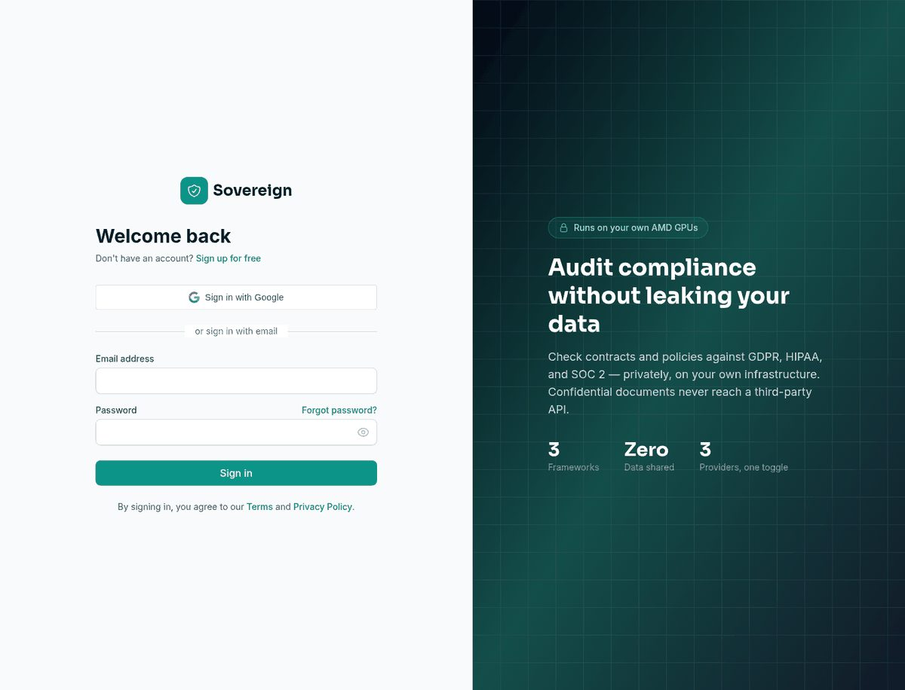
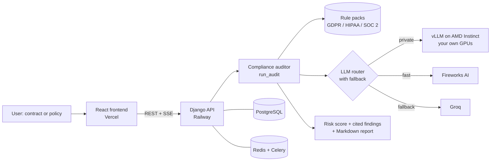

# Sovereign — Private Compliance Audits

**Sovereign is a self-hosted AI agent that audits contracts and policies against GDPR, HIPAA, and SOC 2 — running entirely on your own AMD Instinct GPUs, so confidential documents never leave your infrastructure.**


**Live:** [sovereign-compliance.vercel.app](https://sovereign-compliance.vercel.app) · **API:** [sovereign-production-f00d.up.railway.app](https://sovereign-production-f00d.up.railway.app)

## At a Glance

| | |
|---|---|
| **What it does** | Audits a contract or policy against **GDPR, HIPAA or SOC 2** and returns a risk score plus one finding per rule, each with the regulation reference, the evidence quoted from the document, the gap and a recommendation |
| **Why it is different** | Inference can run on **your own AMD Instinct GPUs (vLLM on ROCm)**, so confidential documents never reach a third-party API. One toggle switches to Fireworks or Groq when speed matters more than privacy |
| **Rule packs** | 19 cited rules: GDPR (7), HIPAA (6), SOC 2 (6), as plain JSON in `backend/agents/rulesets/`; adding a framework means adding a file |
| **Deterministic shape** | The LLM judges each rule, but the output always has the same structure (one finding per rule), and the risk score is computed in code, not by the model |
| **Engineering** | Multi-provider LLM router with automatic fallback, YAML workflow engine, Celery jobs, Redis, PostgreSQL, Docker; 83 automated agent tests |



---

## The problem

Regulated teams (legal, healthcare, finance, security) can't paste confidential contracts and policies into a public LLM API — it's a data-governance non-starter. So compliance review stays manual, slow, and expensive.

## The solution

Sovereign runs an open model on **your own AMD Instinct GPUs via vLLM/ROCm**. You upload a document, pick a framework, and the agent returns a **cited, severity-ranked risk report** — without the document ever reaching a third party. A single toggle lets you trade privacy for speed:

| Provider | When to use | Privacy |
|----------|-------------|---------|
| **AMD Instinct** (vLLM/ROCm) | Confidential documents | Runs on your own GPUs — data never leaves |
| **Fireworks AI** | Speed over privacy | Managed cloud inference |
| **Groq** | Fast fallback | Managed cloud inference |

The provider layer is a single abstraction with automatic fallback — adding a provider is a one-class change.

## How the audit works

1. **Ingest** — paste or upload a contract / policy / privacy notice.
2. **Audit** — the agent checks the document against every rule in the chosen framework (GDPR, HIPAA, SOC 2), using retrieval + structured LLM reasoning.
3. **Report** — a risk score, severity-ranked findings (each mapped to a specific article/control with the evidence quoted from your document), recommendations, and a downloadable Markdown report.

Frameworks ship as cited rule packs in `backend/agents/rulesets/` (GDPR, HIPAA, SOC 2) and are trivially extensible.

---

## Beyond compliance — a full private agent platform

The same multi-provider runtime that powers the auditor also ships:

- A **streaming chat agent** with function-calling and tool use.
- **30+ document, research, and writing tools** (summarize, research, citations, etc.).
- A **YAML workflow engine** for multi-step agents (e.g. `compliance_audit.yaml`), plus an agent marketplace.

Everything runs through the same private inference layer.

## Tech stack

**Backend** — Python 3.11 · Django 5.2 + DRF · PostgreSQL · Redis · Celery · gunicorn
**AI** — multi-provider router (`backend/agents/llm.py`): AMD Instinct (vLLM/ROCm, OpenAI-compatible), Fireworks AI, Groq, OpenAI, Anthropic, Ollama
**Frontend** — React 18 + TypeScript · Tailwind CSS · React Query · Zustand · Framer Motion
**Infra** — Docker · WhiteNoise · Railway (backend) · Vercel (frontend)

## Architecture



**How the risk score is computed:** each rule has a severity weight (critical 10, high 6, medium 3, low 1). Each finding's status contributes a share of that weight (compliant 0, partial 0.5, not addressed 0.7, non-compliant 1.0). The score is the weighted total as a percentage of the maximum, banded into Minimal, Low (>0), Medium (≥20), High (≥45) or Critical (≥70).

Code layout:

```
Frontend (React, Vercel)
   │  REST + SSE
   ▼
Django API (Railway)
   ├─ agents/                  multi-provider LLM router, agent runner, workflow engine
   │   ├─ llm.py               AMD / Fireworks / Groq / … providers (one interface)
   │   ├─ compliance.py        run_audit() + render_report() + registry tools
   │   ├─ rulesets/            gdpr.json · hipaa.json · soc2.json
   │   └─ workflows/           compliance_audit.yaml, …
   ├─ tools/                   30+ AI tools (ai_service.py)
   ├─ accounts/ payments/ research/ community/ solutions/
   └─ core/                    settings, middleware, celery
        │
        ├─ PostgreSQL          (Railway plugin)
        ├─ Redis               (cache, Celery broker, provider key pool)
        └─ AMD vLLM endpoint   (AMD Developer Cloud — set AMD_VLLM_BASE_URL)
```

Compliance API:
- `GET  /api/agents/compliance/frameworks/` — available frameworks
- `POST /api/agents/compliance/audit/` — `{document_text, framework, provider}` → findings + Markdown report

---

## Quick start (local, Docker)

```bash
cp backend/.env.example backend/.env   # add FIREWORKS_API_KEY and/or GROQ_API_KEY
docker-compose -f docker-compose.dev.yml up
```

- Frontend → http://localhost:3000
- API → http://localhost:8000/api
- Admin → http://localhost:8000/admin

Seed the tool catalogue (once): `docker-compose -f docker-compose.dev.yml exec backend python manage.py populate_tools`

### Key environment variables

| Variable | Purpose |
|----------|---------|
| `AGENTS_DEFAULT_PROVIDER` | `fireworks` \| `groq` \| `amd` (default provider) |
| `AGENTS_FALLBACK_PROVIDERS` | comma list, e.g. `groq,amd` |
| `FIREWORKS_API_KEY` / `FIREWORKS_MODEL` | Fireworks managed inference |
| `GROQ_API_KEY` / `GROQ_MODEL` | Groq managed inference |
| `AMD_VLLM_BASE_URL` / `AMD_VLLM_MODEL` | self-hosted AMD Instinct vLLM endpoint (the private path) |
| `DATABASE_URL` / `REDIS_URL` | Postgres + Redis |
| `SECRET_KEY`, `ALLOWED_HOSTS`, `CORS_ALLOWED_ORIGINS` | Django / prod |

See [`docs/DEPLOYMENT.md`](docs/DEPLOYMENT.md) for the full deployment checklist and `backend/.env.example` for every variable.

## Deployment

- **Backend → Railway** (builds `backend/Dockerfile`; runs migrate → seed tools → gunicorn; Postgres + Redis plugins).
- **Frontend → Vercel** (CRA static build; `frontend/.env.production` points at the Railway API).

> The AMD-private provider runs on **AMD Developer Cloud** (Railway/Vercel have no AMD GPUs); point `AMD_VLLM_BASE_URL` at that endpoint. Fireworks and Groq work from Railway directly.

## Testing

```bash
cd backend && pytest agents/tests -q     # provider router + compliance + workflow + API tests
cd frontend && npx tsc --noEmit          # type-check
```
